# Live follow-up proof

Source revision: `7d1df70b0d1b0724b87f74ada443c4132e64c621`. Base: `7d1b2d3`. Counts exclude blank/comment lines and Python docstrings.

```mermaid
---
title: Discovery safety and ora8 test plan — 7d1df70
---
flowchart TB
classDef plus fill:#dcfce7,stroke:#15803d
classDef minus fill:#fee2e2,stroke:#b91c1c
classDef wait fill:#fff7d6,stroke:#b7791f
subgraph discovery[Read-only discovery]
a["Existing cloudflared process arguments"] -->|unchanged input| old["- Per-argument regex can expose split credential values"]:::minus
old -.->|replaced| b["+ Token-aware split/inline redaction; preserve safe config path<br/><small><u>runtime/node_agent.py:315</u><br/><b><font color="#15803d">+22</font></b> <b><font color="#b91c1c">-2</font></b></small>"]:::plus
b -->|~ sanitized values| inventory["Existing worker inventory and classification"]
inventory -->|proof| test["8 discovery tests pass. Fake /proc covers secrets.<br/>Real collectors succeed on six registered hosts; ora7 times out."]
end
subgraph lab[Ora8 isolated installation validation]
guard["+ Require ora8 + dedicated nonroot account; isolate XDG, port and process ownership<br/><small><u>scripts/remote-lab-smoke.sh</u><br/><b><font color="#15803d">+227</font></b> <b><font color="#b91c1c">-0</font></b></small>"]:::plus -->|+ allowed account| install["+ Fresh and repeat install; OAuth PKCE/refresh/MCP;<br/>recovery; upgrade/rollback; private cleanup"]:::plus
install -->|+ redacted result only| result["+ PASS labels and private result JSON"]:::plus
guard -->|+ other account| refuse["+ Refuse before installation. Local guard and syntax checks pass."]:::plus
install -.->|unproven real path| blocked["Ora8 run blocked by owner Tailscale identity check.<br/>No account, registry, service or route changes occur yet."]:::wait
end
```

The lab flow has no ora8 runtime proof yet. The owner must complete Tailscale authentication.
Real HTTP checks in the isolated Lightsprint gateway pass all three public/Basic/form client flows, including PKCE, refresh, mixed-grant narrowing, and nonempty MCP tool results.
The desktop still advertises only public OAuth clients. It is not updated.
