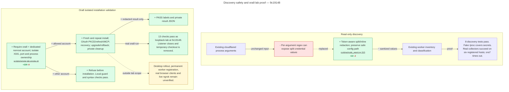

# Live follow-up proof

Source revision: `9c19148262ada84be1f5d1345afbf8bb43ef9f43`. Base: `7d1b2d3`. Counts exclude blank/comment lines and Python docstrings.
The [real ora8 result](ORA8-LAB-RESULT-2026-10-28.json) supersedes the earlier identity blocker.

The ora8 lab flow has real runtime proof. All 13 checks pass through authenticated Tailscale SSH as the dedicated account.
The port regression test rejects a live listener and accepts closed TIME_WAIT connections.
The saved JSON contains check names and cleanup state. It contains no credentials, hashes, cookies, or enrollment links.
Real HTTP checks in the isolated Lightsprint gateway pass all three public/Basic/form client flows, including PKCE, refresh, mixed-grant narrowing, and nonempty MCP tool results.
The desktop still advertises only public OAuth clients. It is not updated.
