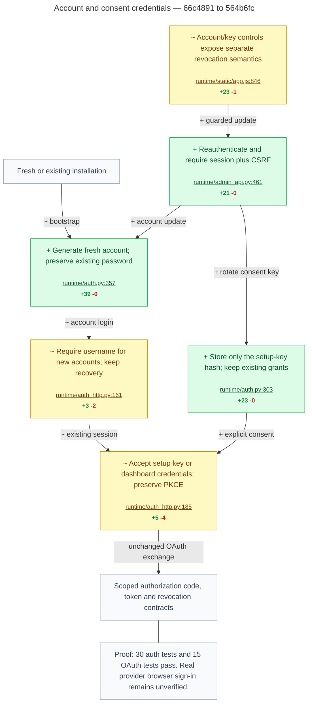
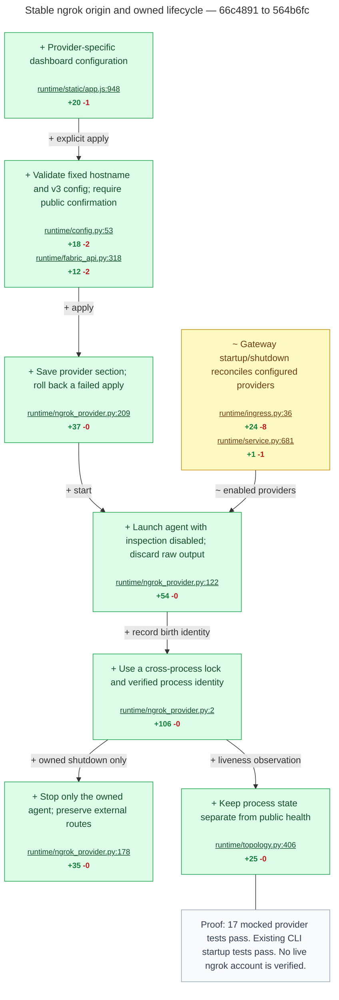
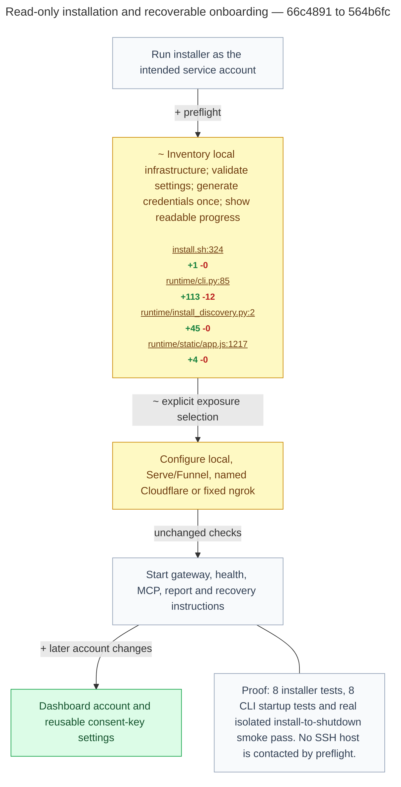

# Resumed flow proof

Old: `66c4891f7029f22cdc1df0a05af13d69106f34e4` (merge-base with origin/main). New source: `564b6fc511db351444c3d21f4b881002341e2a5d`.

Counts exclude tests, comments, and Python docstrings. Files shared by steps are split by the edited source region.

## Account and consent credentials

## Stable ngrok origin and owned lifecycle

## Read-only installation and recoverable onboarding

## Scope and limits

Services Edit is verified by six Node tests and the focused field capture. Its small scroll/focus change does not need another chart.

DOTRIX geometry, branding references, and documentation have no additional backend flow. Six current stills cover their visible changes.

Real browser clients, a live ngrok account, and ora8 worker installation remain unverified as recorded in the checkpoint. The newest wordmark export succeeds and receives separate visual proof.
